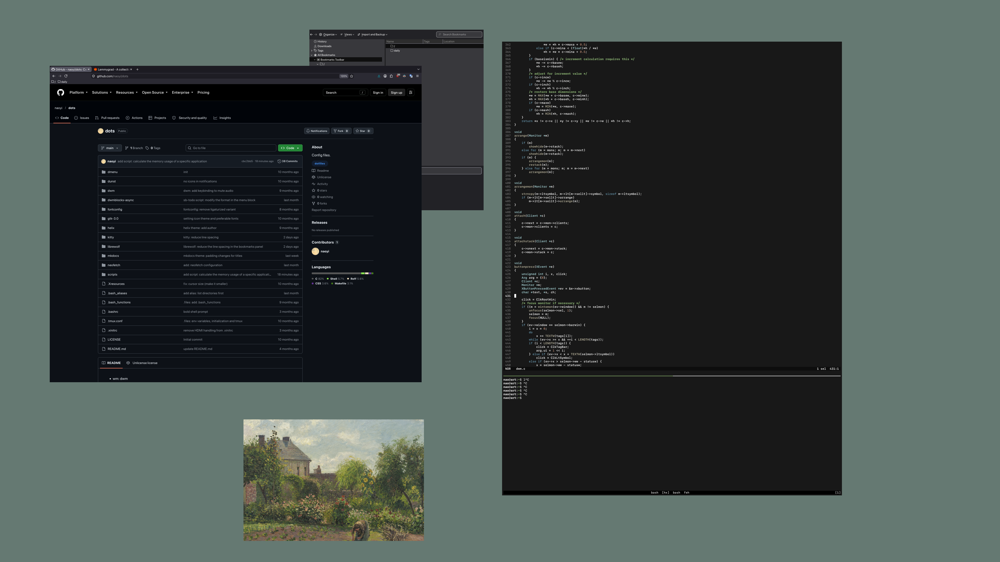

# dots

Configuration files for a minimalist and uncomfortable yet functional environment.

- wm: dwm
- launcher: dmenu
- bar: dwmblocks-async
- terminal: kitty
- editor: helix
- notification-daemon: dunst
- browser: librewolf
- notes: mkdocs

